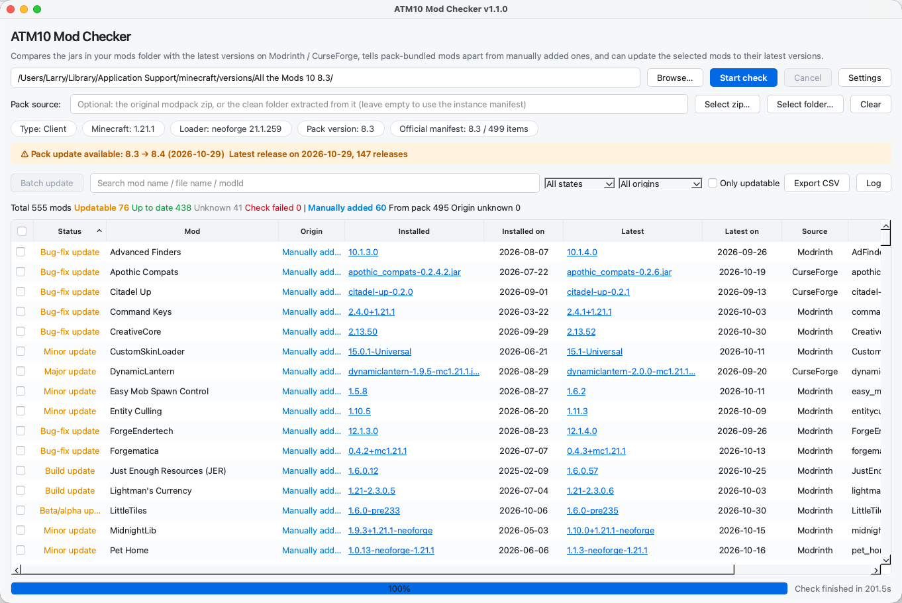
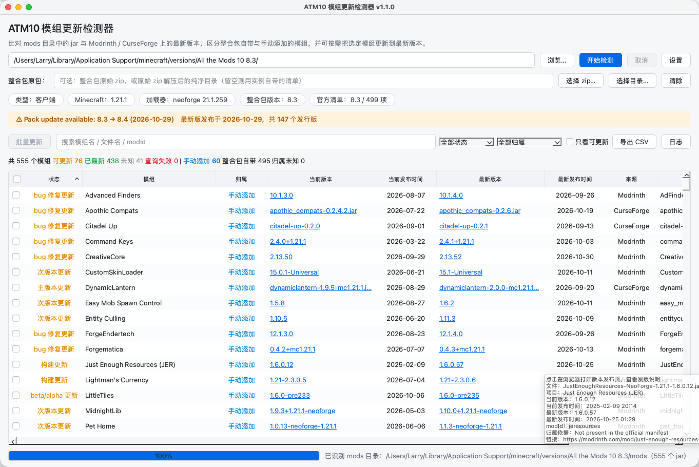

# ATM10 Mod Checker

**English** | [简体中文](README.zh-CN.md)

[](https://github.com/pnnh/mcmodchecker/releases)
[](https://github.com/pnnh/mcmodchecker/actions/workflows/release.yml)
[](LICENSE)

A desktop tool that checks every mod in an **All the Mods 10 (ATM10)** Minecraft instance
against the public mod registries, tells you which mods have updates, and distinguishes mods
that ship with the modpack from the ones you added yourself.

The app ships as a **single self-contained executable** — Python and Qt are bundled, nothing
else needs to be installed.

> ### Read this first
>
> This is a **personal hobby project**, written mostly in collaboration with AI assistants.
> It has **not** been rigorously tested, and it exists primarily because it was useful to me
> and a few friends. Use it at your own risk.
>
> - **Back up your instance** — at minimum copy the `mods` folder somewhere safe — before you
>   let the app replace anything. The updater is written to be rollback-safe, but you should
>   not take that on faith.
> - **Scope**: only the **All the Mods 10** pack (NeoForge 1.21.1) has been exercised.
>   Other modpacks, other Minecraft versions, and vanilla / Fabric / Forge instances have
>   **not** been tested. Version detection, origin classification and update suggestions may
>   be wrong or unavailable there.
> - No warranty of any kind. See [`LICENSE`](LICENSE) (AGPL-3.0-or-later) for the exact terms.
> - **Issues only.** There is no support promise and no external contribution process — see
>   [Feedback](#feedback).

## Screenshots

| English | 简体中文 |
| --- | --- |
|  |  |

---

## Features

| | |
| --- | --- |
| **One-click audit** | Point it at an instance folder (or a `mods` folder) and it scans every `*.jar` in one pass. |
| **Hash-based identification** | Mods are matched by SHA-1 on Modrinth and CurseForge, so renamed jars are still recognised correctly. |
| **Update detection** | Compares the installed version with the latest release that supports your Minecraft / loader version, and reports the size of the jump (major / minor / patch / build). |
| **Origin classification** | Reads the official ATM10 `manifest.json` and marks each mod as **Bundled with the pack** or **Manually added**, so you can see what is “extra”. |
| **Safe batch updates** | Select any number of mods and let the app download and replace them, verified and rollback-safe. |
| **Everything is sortable and filterable** | Filter by state or origin, search by name, sort by any column, click a version to open its changelog page. |
| **CSV export** | Dump the whole report (status, versions, dates, sources, links, notes) to a spreadsheet. |
| **Bilingual UI** | English and Simplified Chinese, following the operating system by default and switchable at runtime. |
| **Rotating logs** | Diagnostics land in `.ATM10ModChecker/logs/latest.log` next to the executable, sliced daily, mirrored to the console when launched from a terminal. |

---

## Download & run

Get the latest build from the [Releases](https://github.com/pnnh/mcmodchecker/releases) page.

The app is portable: it keeps its settings, cache and logs in a `.ATM10ModChecker` folder created
next to the executable, so it can live wherever you put it and can be removed again without a
trace — see [Files & uninstall](#files--uninstall).

### Windows (x64)

1. Download `ATM10ModChecker-windows-x64.exe` (or the `.zip` if you prefer an archive).
2. Double-click it. No installation, no Python, no admin rights.

### Linux (x64)

1. Download `ATM10ModChecker-linux-x64.zip` and extract it.
2. Run it:

   ```bash
   chmod +x ATM10ModChecker
   ./ATM10ModChecker
   ```

   > The bare `ATM10ModChecker-linux-x64` asset also works, but release downloads lose the
   > executable bit, so remember `chmod +x` first.

### Verify the build provenance

Every asset is built by GitHub Actions and carries an
[Artifact Attestation](https://docs.github.com/actions/using-artifact-attestations)
(SLSA build provenance), so you can prove the binary was produced from this repository:

```bash
gh attestation verify ATM10ModChecker-windows-x64.exe --repo pnnh/mcmodchecker
gh attestation verify ATM10ModChecker-linux-x64.zip  --repo pnnh/mcmodchecker
```

### Run from source

```bash
git clone https://github.com/pnnh/mcmodchecker.git
cd mcmodchecker
python -m venv .venv && source .venv/bin/activate    # Windows: .venv\Scripts\activate
pip install -r requirements.txt
python main.py
```

Requires Python 3.10+ (3.12 recommended). `PySide6-Essentials` is the only dependency.

---

## Usage

1. **Choose the instance folder** with *Browse…*. The app looks for `mods/`, `manifest.json`,
   `minecraftinstance.json`, `modlist.html` and the NeoForge `libraries/` layout, so selecting
   the instance root is enough. If you launched the app with a path argument it is pre-filled.
2. *(Optional)* **Select the pack source** — the original ATM10 `.zip` or an extracted copy of it.
   This is the most reliable way to decide which mods belong to the pack; when it is omitted the
   app falls back to the local metadata, then to the remote `manifest.json` inside the official zip
   (read with HTTP range requests, a few hundred KB).
3. Press **Start check**. Rows appear while the scan is still running.
4. Review the table, then either tick rows and press **Update selected**, or click the status cell
   of a single mod to update just that one.
5. **Export CSV** to keep the report.

### Columns

| Column | Meaning |
| --- | --- |
| ☑ | Row selection; the header checkbox selects every mod that can be updated. |
| Status | Up to date / major / minor / patch / build update / unknown / check failed. |
| Mod | Project title, falling back to the mod id or file name. |
| Origin | *Bundled with the pack* vs *Manually added*. |
| Installed / Latest | Versions, with the release date next to them. Click to open the changelog page. |
| Source | Modrinth, CurseForge, or unrecognised. |
| File name | The jar on disk. |

Hovering a row shows the full details (project, ids, dates, and the reason a check failed).

### What an update does

For each selected mod the app:

1. downloads the file from the official CDN (rate-limited, cancellable);
2. verifies the SHA-1 and the expected file size;
3. writes it to a temporary `.part` file inside `mods/`;
4. renames the old jar to `*.bak`, then atomically replaces it with the new file;
5. rolls the `.bak` back if anything fails, so you never end up with a broken half-mod.

A confirmation dialog lists exactly which mods will be replaced, and blocks the update until you
acknowledge the ones that cross a **major** version boundary. Old jars stay on disk as `.bak`
files — delete them once you are happy.

---

## Settings

Open *Settings* from the toolbar:

| Setting | Description |
| --- | --- |
| Language | *Follow system* (default), English, or 简体中文. Applies immediately, no restart. |
| Minecraft / loader | Leave empty for auto-detection (falls back to 1.21.1 / NeoForge). |
| Modrinth / CurseForge | Enable or disable each source. |
| CurseForge API key | Optional. Without a key the app uses a public read-only proxy (`api.curse.tools`). |
| Include disabled mods | Also scan `*.jar.disabled`. |
| Concurrency | Number of parallel requests (default 6). Lower it if you hit rate limits. |
| Pack source | The original modpack zip / extracted folder used for origin classification. |

Settings are stored **next to the executable**, in the `.ATM10ModChecker` folder:

- Windows: `.ATM10ModChecker\settings.json` beside `ATM10ModChecker.exe`
- Linux / macOS: `.ATM10ModChecker/settings.json` beside the binary

As long as the program folder is writable, nothing is written to `%APPDATA%`, your home
directory or the registry, so deleting that one folder removes every trace of the app — see
[Files & uninstall](#files--uninstall).

### Language

On first start the language is picked from the operating system locale: Simplified Chinese when
the system language is Chinese, English otherwise. You can override it at any time from the
language selector at the top of the settings dialog — the whole interface is re-translated on the
fly.

---

## Logs

All diagnostics are written to `.ATM10ModChecker/logs` next to the executable:

```
ATM10ModChecker.exe
.ATM10ModChecker/
  settings.json                    # your settings
  cache/                           # cached API responses
  logs/
    latest.log                     # current session, always up to date
    ATM10ModChecker-2026-10-29.log # previous days, 30 kept
```

- `latest.log` is **always** the newest log; when the day rolls over the previous content is renamed
  to `ATM10ModChecker-YYYY-MM-DD.log` and a fresh `latest.log` is created.
- Only `INFO` and above is recorded (Info / Warning / Error / Critical), including Qt's own
  warnings and every uncaught exception from the main thread and from worker threads.
- When the app cannot write next to the executable (read-only folder, sandboxing), everything —
  settings, cache and logs — falls back to the user directory: `%APPDATA%\ATM10ModChecker` on
  Windows, `~/.local/state/ATM10ModChecker` on Linux,
  `~/Library/Application Support/ATM10ModChecker` on macOS.
- When started from a terminal the same lines are echoed to standard output — including on Windows,
  where the windowed executable attaches to the parent console.

To report a bug, attach `.ATM10ModChecker/logs/latest.log`.

---

## Files & uninstall

The whole application state lives in one folder created **next to the executable**:

```
ATM10ModChecker.exe                # or ATM10ModChecker on Linux/macOS
.ATM10ModChecker/
  settings.json                    # language, API key, last folder, pack source, …
  cache/                           # API responses; safe to delete at any time
  logs/                            # latest.log + up to 30 daily archives
```

Uninstalling therefore only takes a few seconds:

1. close the app;
2. delete the executable;
3. delete the `.ATM10ModChecker` folder in the same directory.

There is no installer, no registry entry, no service, no autostart entry, and nothing left in
`%APPDATA%`, your home directory or anywhere else — provided the program folder was writable.

A few notes:

- **The app never modifies your Minecraft instance by itself.** It only writes inside `mods/`
  when you press an update button, and the only traces it leaves behind are the `*.bak` files next
  to the replaced jars. Delete those as well if you want a pristine folder.
- **Whatever folder holds the binary holds the data.** An old copy in `~/Downloads` keeps its own
  settings there; if you later move the executable to `~/Applications`, move
  `.ATM10ModChecker` along with it, otherwise it starts with fresh settings.
- **Read-only locations.** If the program folder cannot be written to (for example
  `C:\Program Files`, or running straight from a mounted disk image), settings, cache and logs
  fall back to the user profile paths listed in the [Logs](#logs) section. Delete that folder too,
  and move the executable somewhere writable if you want the portable behaviour back.
- **Upgrading from an older build** that kept settings in the user profile: the old
  `settings.json` is copied once into the new location on first start. The old folder is left
  behind untouched — delete it after the upgrade if you want it gone.
- Uninstalling the tool does not restore mods you already updated, and does not touch the modpack
  itself.

---

## Data & privacy

The app only talks to the following hosts, and only to identify mods and fetch the modpack manifest:

- `api.modrinth.com` — hash lookups and version metadata;
- `api.curseforge.com` / `api.curse.tools` — CurseForge lookups (the proxy is used when no API key is set);
- `api.cfwidget.com` and the ATM10 CDN hosts — modpack release list and `manifest.json`.

No telemetry, no account, nothing is uploaded. Responses are cached locally in
`.ATM10ModChecker/cache` next to the executable, so re-running a check is fast and does not
hammer the APIs.

> Rate limits: Modrinth allows 300 requests/minute per IP; the app uses at most 4 requests/second for
> Modrinth and 6 for CurseForge, and backs off on HTTP 429.

---

## Building & releasing

The repository ships a [release workflow](.github/workflows/release.yml) that triggers on any
semantic-version tag (`v1.1.0`, `v1.2.0-rc1`, …). It:

1. verifies that the tag matches `__version__` in `modchecker/__init__.py`;
2. builds a `--onefile` executable with PyInstaller on Windows and Ubuntu 22.04;
3. runs the packaged binary with `--version` as a smoke test;
4. generates an Artifact Attestation for the executable and the zip;
5. publishes a GitHub Release with `ATM10ModChecker-windows-x64.exe`,
   `ATM10ModChecker-linux-x64.zip` and friends.

To cut a release:

```bash
# bump the version in modchecker/__init__.py first
git tag v1.2.0
git push origin v1.2.0
```

Release notes are written by hand in `.github/release-notes/v<tag>.md`; the workflow prepends them
to the download table, the provenance section and GitHub's generated changelog. A missing notes
file is not an error — the release then carries the generated changelog only.

Manual builds:

```bash
pip install -r requirements.txt pyinstaller
pyinstaller --noconfirm --clean --onefile --name ATM10ModChecker main.py
# Windows: add --windowed to avoid the console window
```

### Command line

```bash
ATM10ModChecker             # open the GUI
ATM10ModChecker /path/mods  # open the GUI with a folder pre-selected
ATM10ModChecker --version   # print the version and exit
```

---

## Project layout

```
main.py                    # entry point: logging, fatal error handling, Qt app
modchecker/
  logging_setup.py         # latest.log + daily rotation + console mirroring
  i18n.py                  # English / Chinese string catalogs
  appconfig.py             # settings & cache locations
  scanner.py               # instance detection, jar scanning, SHA-1 hashing
  checker.py               # orchestration: identify → manifest → versions → classify
  official.py              # official modpack index & origin classification
  packmeta.py              # manifest / modlist / minecraftinstance readers
  updater.py               # verified, rollback-safe mod replacement
  versioning.py            # version comparison & change levels
  remotezip.py, net.py, cache.py, jarinfo.py
  providers/               # Modrinth, CurseForge, ATM10 clients
  ui/                      # PySide6 window, table model, workers, settings dialog
```

---

## Known limitations

- **Only ATM10 is supported.** The detection logic, the official manifest handling and the
  origin classification are all built around the ATM10 pack on NeoForge 1.21.1. Other packs,
  other Minecraft versions, and vanilla / Fabric / Forge instances are untested — expect
  version detection and origin classification to be unreliable or simply "Unknown" there.
- **Personal project, limited testing.** There is no automated test suite, only smoke tests in
  CI. Behaviour around unusual mods, unusual folder layouts and rate-limited APIs has not been
  exhaustively explored, and no checklist was ever worked through. Treat every update as an
  experiment: keep a backup and use the tool with caution.
- **CurseForge only distributions**: some files have no public download URL; those mods are marked as
  updatable but the direct link is unavailable, so the app points you to the file page instead.
- **Mods outside Modrinth / CurseForge** (private, self-built, or abandoned jars) cannot be
  identified; they show up as *Unrecognised* and are never touched.
- **Offline use** is limited to whatever is already cached — identification and version checks need
  network access.

---

## Feedback

This is a personal project, so **external contributions are not accepted — please do not open
pull requests.** Reviewing and maintaining other people's patches is more time than I am willing
to spend on a hobby tool; PRs will be closed without review.

- **Issues are welcome** — reproducible bugs, and suggestions you are fine with possibly never
  being implemented.
- When reporting a crash, attach `.ATM10ModChecker/logs/latest.log` and paste the output of
  `ATM10ModChecker --version`.
- The code is AGPL-3.0-or-later, so you are free to fork it and maintain your own build with
  whatever changes you need.

---

## License

Copyright (C) 2026 pnnh.

This project is free software licensed under the
**[GNU Affero General Public License, version 3 or later](LICENSE)** (`AGPL-3.0-or-later`).
In short:

| | |
| --- | --- |
| You may | run, study, modify and redistribute it, including commercially. |
| You must | keep it under the AGPL, publish the source of any modified version you distribute, and — because of AGPL §13 — offer that source to anyone who interacts with your modified version over a network. |
| There is | **no warranty**, and no liability for broken instances, lost mods or anything else. |

This project was chosen to be AGPL rather than MIT/Apache because it is a tool that people
run, modify and (potentially) wrap into a service; the AGPL keeps those modified versions
open. Qt is LGPL-3.0, which is compatible with, and can be combined into, an AGPL-3.0 work.

Third-party components that end up inside the released executables — PySide6 / Qt
(LGPL-3.0), CPython (PSF-2.0) and the PyInstaller bootloader (GPL-2.0 with the bootloader
exception) — are documented, together with their full license texts, in
[`THIRD-PARTY-NOTICES.md`](THIRD-PARTY-NOTICES.md) and [`licenses/`](licenses/).
